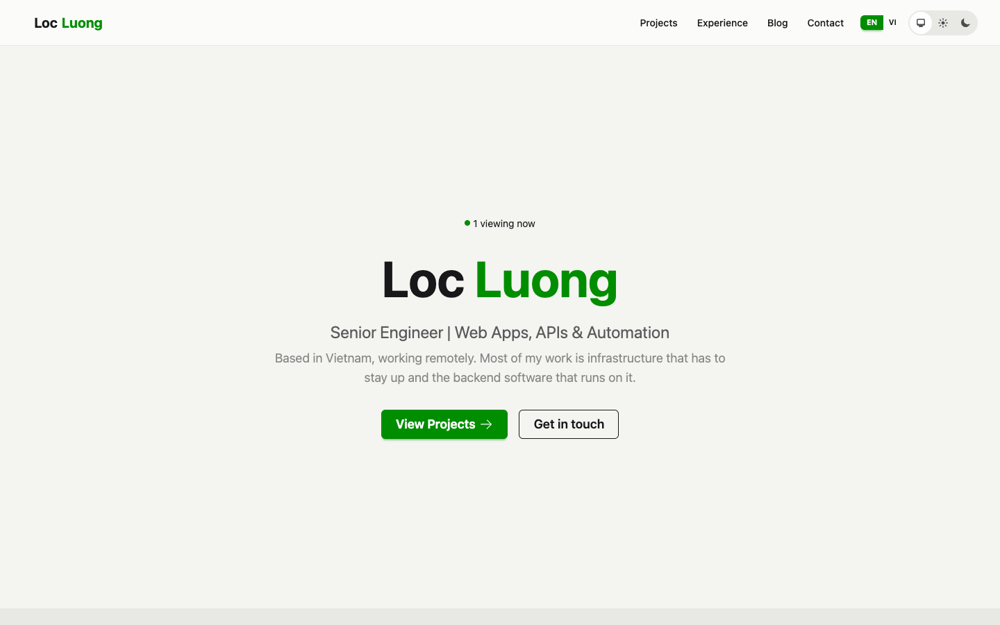

# Loc Luong, portfolio

[](https://github.com/mqa8668/portfolio/actions/workflows/ci.yml)

Personal portfolio site built with Elixir and Phoenix 1.8 LiveView. The home page shows live BEAM stats (process count, memory, uptime, schedulers), a visitor count from Phoenix Presence, and a terminal-style panel fed by those stats. Projects and blog posts are Markdown files compiled at build time with NimblePublisher.



Live at https://loc.forgiolab.com.

## Stack

- Elixir, Phoenix 1.8, Phoenix LiveView
- Phoenix Presence and PubSub
- NimblePublisher with Makeup for Markdown content
- Ecto and PostgreSQL
- Tailwind CSS and daisyUI

## Run locally

Requirements: Elixir, Erlang/OTP, and a PostgreSQL server reachable with the credentials in `config/dev.exs` (user `postgres`, password `postgres`).

```
mix setup
mix phx.server
```

The dev server listens on http://localhost:6868 (set `PORT` to change it).

Before committing, run `mix precommit` (compile with warnings as errors, format, test).

## Content layout

- `priv/projects/*.md`: one file per project, with an Elixir map as frontmatter (title, description, tags, tech, date, featured, status, metrics).
- `priv/blog/*.md`: blog posts, same format.

Content is read at compile time, so recompile after editing these files.
